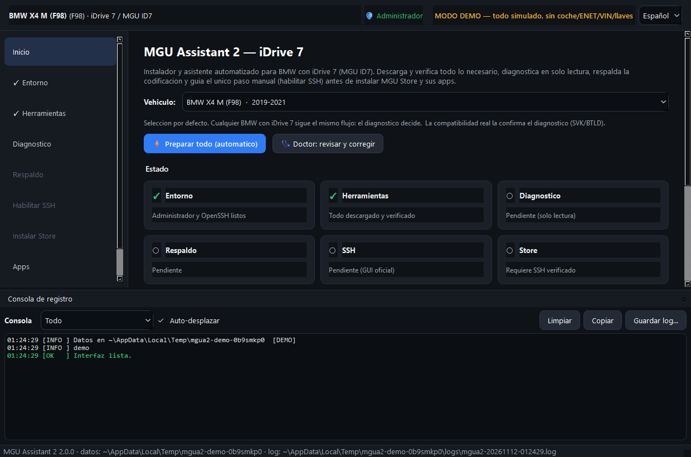
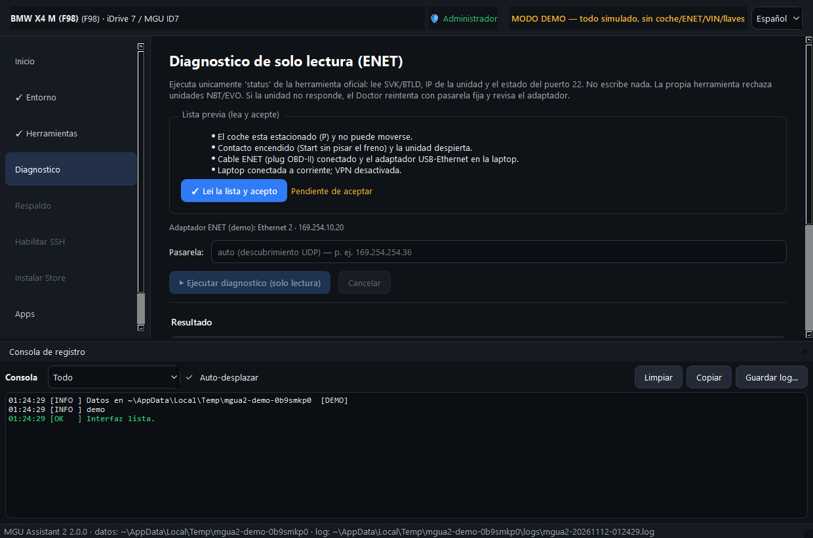
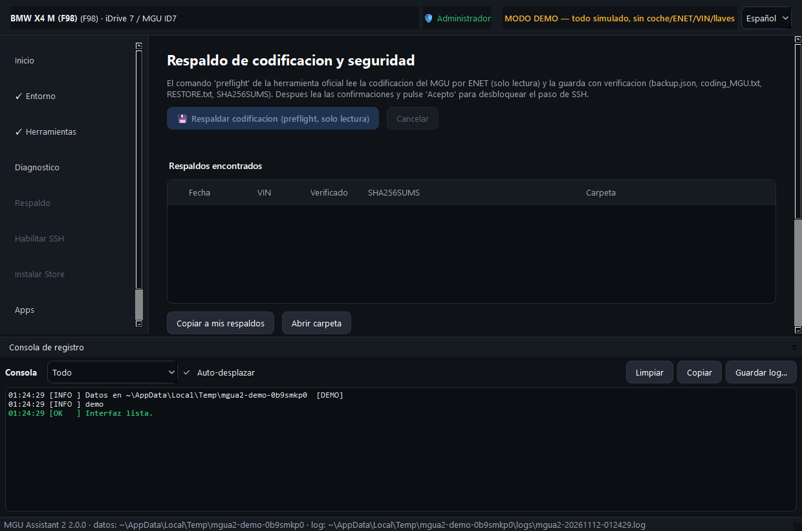
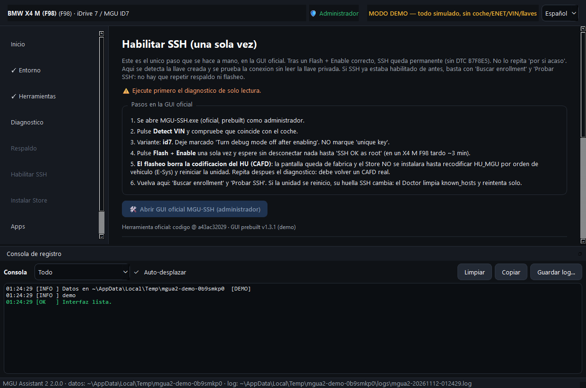
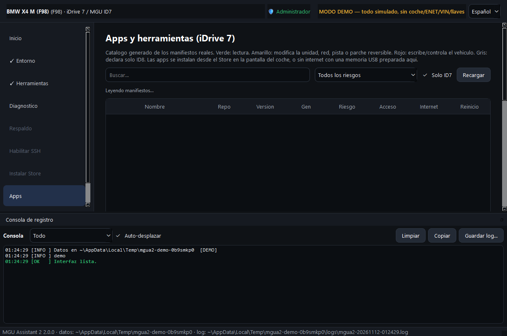
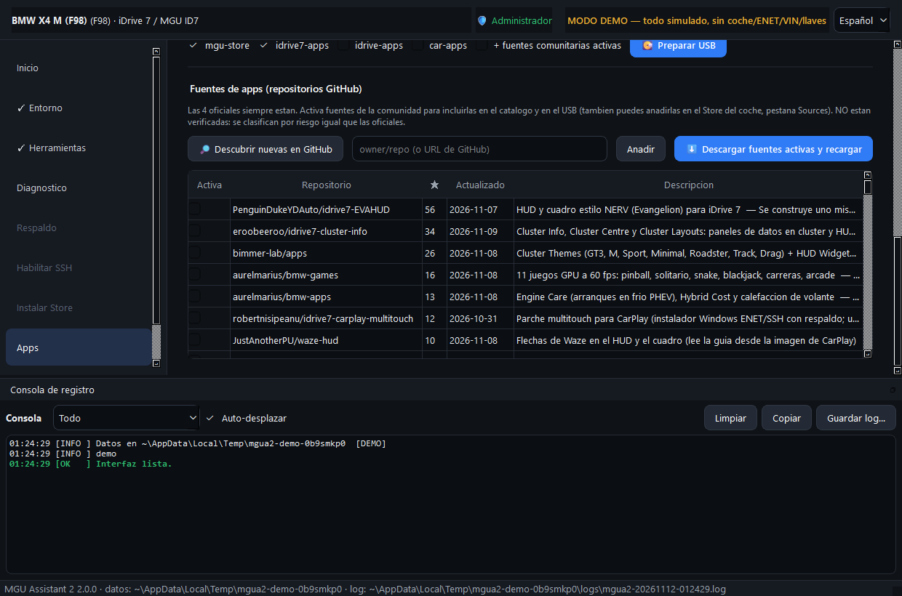

# MGU Assistant 2

[English](README.md) | **Español**

Instalador y asistente automatizado para Windows, para BMW con **iDrive 7 (MGU ID7)**. Maneja las
herramientas de la comunidad que habilitan root SSH en el head unit e instalan la
[MGU Store](https://github.com/robertnisipeanu/mgu-store), todo en una ventana guiada con consola
en vivo y un **Doctor** que reconoce los fallos comunes y corrige los que puede hacer con seguridad.

La interfaz está en **español e inglés** (selector arriba a la derecha, o `--lang es|en`). Se probó
en un BMW X4 M 2021 (F98), pero nada es exclusivo de ese modelo: lo que se permite depende de lo que
reporta el diagnóstico del propio coche (SVK / BTLD), nunca del modelo que elijas.

> **Aviso.** Proyecto no oficial, sin relación con BMW AG. Habilitar SSH **reprograma parte del
> software del head unit y borra su codificación (CAFD)**. También borra los emparejamientos de la
> BMW Digital Key y reinicia los perfiles de conductor. Necesitas cómo recodificar `HU_MGU` después
> (E-Sys, BimmerCode o un taller). Puede afectar la garantía. Trabaja con el coche estacionado y con
> una fuente de alimentación regulada. Lee antes [SECURITY.es.md](SECURITY.es.md) y la sección
> [Después del flasheo](#después-del-flasheo-se-borra-la-codificación).

**Estado: 2.0.0-beta.** Usado en un coche real (X4 M F98, iDrive 7 016.012): diagnóstico de solo
lectura, respaldo de codificación, el único flasheo en la GUI oficial (unos 3 minutos),
`enable`/`persist`, root SSH con el modo debug apagado y sin DTC. Después de recodificar `HU_MGU`
se instalaron la MGU Store y apps. iDrive 8 / 8.5 quedan fuera de alcance por diseño.

**Descarga:** la versión portable para Windows está en la
[página de Releases](https://github.com/ALMSTRA/mgu-assistant-2/releases). Descomprímela donde
quieras (sirve una memoria USB) y deja la carpeta junta. No está firmada: SmartScreen avisa la
primera vez, elige _Más información_ y _Ejecutar de todas formas_.

## Capturas

| Inicio | Diagnóstico de solo lectura |
| --- | --- |
|  |  |

| Respaldo de codificación | Habilitar SSH |
| --- | --- |
|  |  |

| Catálogo de apps | Fuentes de la comunidad |
| --- | --- |
|  |  |

## Qué hace

| Paso | Automático | Cómo |
| --- | --- | --- |
| Herramientas | ✅ | Descarga el código de la herramienta de SSH (zip de GitHub, sin git), el `MGU-SSH.exe` precompilado, el `mgu-install` independiente (SHA-256 verificado) y los repos de apps. Conserva tus enrollments y respaldos al actualizar. |
| Entorno | ✅ | Doctor: permisos de administrador (se reabre con UAC), cliente OpenSSH (lo instala), internet, adaptador ENET con dirección `169.254.x.x`. |
| Diagnóstico | ✅ | Ejecuta el `status` oficial (solo lectura) con **su propio intérprete empaquetado** (la laptop no necesita Python). Rechaza unidades NBT/EVO y exige BTLD `00003F36`. Muestra si la codificación (CAFD) está presente. Si no encuentra la pasarela, reintenta con la última que respondió en ese coche y luego informa del enlace ENET: adaptador, vecinos ARP y sondeo del puerto 22. |
| Respaldo | ✅ | `preflight` oficial: lee la codificación del MGU por ENET, verificada, con `SHA256SUMS`. Un solo botón "Acepto" para la lista de seguridad. |
| Habilitar SSH | 👤 una vez | Abre la GUI oficial como administrador para el único flasheo. Después encuentra el enrollment, localiza la unidad aunque haya cambiado de IP y prueba SSH sin leer la llave privada. |
| Store | ✅ | `mgu-install first-install` por el hotspot Wi-Fi del coche o por ENET. Bloqueado, con explicación, mientras la codificación esté borrada. |
| Apps | ✅ catálogo / 💽 USB | Catálogo leído de los manifiestos reales, con colores por riesgo, y una **memoria USB** sin internet (`usb-repo`). |
| Fuentes | 🔎 | Las 4 fuentes que trae la Store más **78 repos de la comunidad verificados** (temas de cuadro, widgets de HUD, juegos, video, utilidades), búsqueda en vivo en GitHub y tus propios `owner/repo`. Todo opcional y sin verificar. Se bloquean los repos que pisarían las herramientas oficiales o la propia Store. |

El flasheo nunca se automatiza: la app abre el `MGU-SSH.exe` oficial y tú pulsas el botón. Nunca
pasa `--force` ni `--yes` y nunca escribe codificación en el coche.

## Ejecutar

```
MGU-Assistant-2.exe              # modo normal (pulsa "Preparar todo")
MGU-Assistant-2.exe --demo       # todo simulado, sin coche
MGU-Assistant-2.exe --lang en    # interfaz en inglés
```

La carpeta debe quedar junta: `MGU-Assistant-2.exe` (interfaz) y `mgua2-cli.exe` (consola; hace de
intérprete de Python para la herramienta oficial). El modo demo trabaja siempre en una carpeta
temporal nueva y nunca toca tus datos reales.

Tus datos quedan en `%LOCALAPPDATA%\MGU Assistant 2\` (`tools/`, `repos/`, `logs/`, `backups/`,
`state/`, `usb/`). La consola censura VIN, llaves, tokens y tu nombre de usuario de Windows.

**Retomar con SSH ya habilitado:** al arrancar la app detecta el enrollment (llave e IP de la
unidad) y desbloquea "Habilitar SSH": Diagnóstico (opcional), Probar SSH, Instalar Store. Sin
repetir respaldo ni flasheo. Si el puerto 22 está cerrado, "Enable" vuelve a enrolar sin flashear.

## Después del flasheo: se borra la codificación

Lo que pasó en el coche de prueba y lo que encontró la investigación (unos 30 reportes públicos,
ninguno conservó la codificación):

- El flasheo reemplaza **un elemento de software**, `SWFL 000056EA` (a `030.016.002`), **sin paso
  de codificación**. En las herramientas de BMW, programar siempre va seguido de codificar, así que
  el CAFD queda vacío: el SVK muestra `CAFD FFFFFFFF_255.255.255` y la unidad trabaja con valores de
  fábrica. La pantalla vuelve a la configuración de fábrica.
- `mgu-install` se niega con código 2 ("coding is missing: it holds default values"), porque sin
  codificación válida el gestor de apps no arranca.
- Pasa en **cada** flasheo o `fix-key`, sin importar la versión anterior. Activar el modo debug (el
  flasheo y cada `enable`) también reinicia el perfil de conductor, la memoria del asiento y la
  sesión BMW ID. La app lo avisa y no ejecuta `enable` si el puerto 22 ya está abierto.
- Solución: recodificar `HU_MGU` por orden de vehículo (E-Sys, o un taller con E-Sys/ISTA);
  BimmerCode funcionó a algunos usuarios, incluido el coche de prueba. Luego reiniciar la unidad,
  repetir el diagnóstico (debe volver un CAFD real) e instalar la Store. Nunca volver a flashear
  para arreglar la codificación.

La app detecta el CAFD borrado, bloquea el paso de la Store con estas instrucciones y enlaza el
`RESTORE.txt` del respaldo y el issue de upstream.

## Desarrollo

```
python -m venv .venv
.venv\Scripts\python -m pip install -r requirements-dev.txt
.venv\Scripts\python -m mgua2 --demo
set QT_QPA_PLATFORM=offscreen && .venv\Scripts\python -m pytest -m "not net"
powershell -File packaging\windows\build.ps1
```

`packaging/mgua2.spec` genera dos ejecutables en una carpeta de PyInstaller. No compiles con la app
abierta desde `dist/`: las DLL de Qt quedan bloqueadas y el build queda a medias (el script se
niega). Las pruebas marcadas `net` usan la API de GitHub, cuya cuota anónima es de 60 consultas por
hora. Los textos de la interfaz se escriben en los dos idiomas donde se usan:
`tr("Probar SSH", "Test SSH")` (ver `mgua2/i18n.py`).

## Limitaciones

- Solo Windows para el flasheo: el `MGU-SSH.exe` precompilado existe solo para Windows. Los scripts
  de macOS están incluidos pero sin probar.
- Las fuentes de la comunidad no están verificadas: revisa cada repo antes de activarlo.
- Hecho contra las herramientas de upstream de noviembre de 2026; su formato de salida puede cambiar.

## Créditos y licencias

Código propio: MIT ([LICENSE](LICENSE)). Orquesta, y descarga al usarse, el trabajo de otros:
[idrive7-8-ssh-root](https://github.com/cauliflowermossgrape/idrive7-8-ssh-root) (Unlicense),
[mgu-store](https://github.com/robertnisipeanu/mgu-store) (GPL-3.0),
[idrive7-apps](https://github.com/cauliflowermossgrape/idrive7-apps) (MIT),
[idrive-apps](https://github.com/robertnisipeanu/idrive-apps) (GPL-3.0) y
[car-apps](https://github.com/IterioDev/car-apps). Ver [THIRD_PARTY_NOTICES.md](THIRD_PARTY_NOTICES.md).
