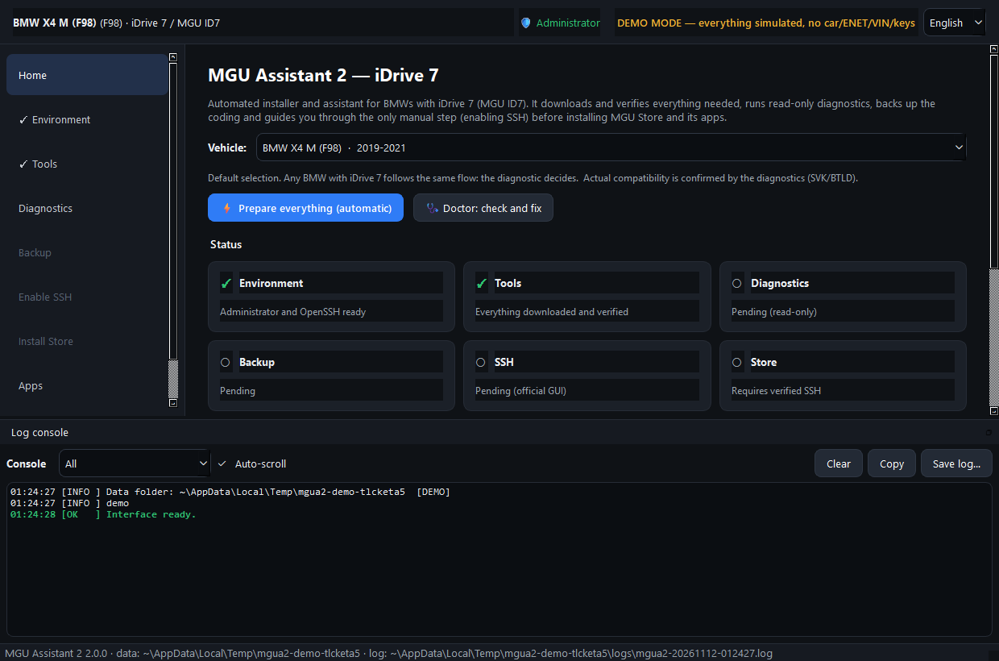
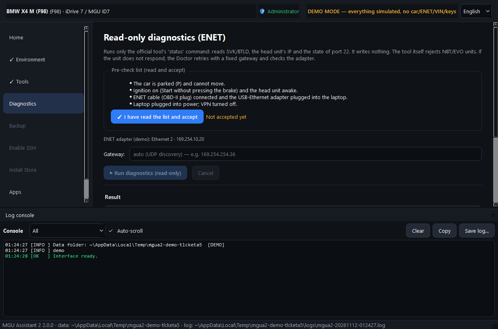
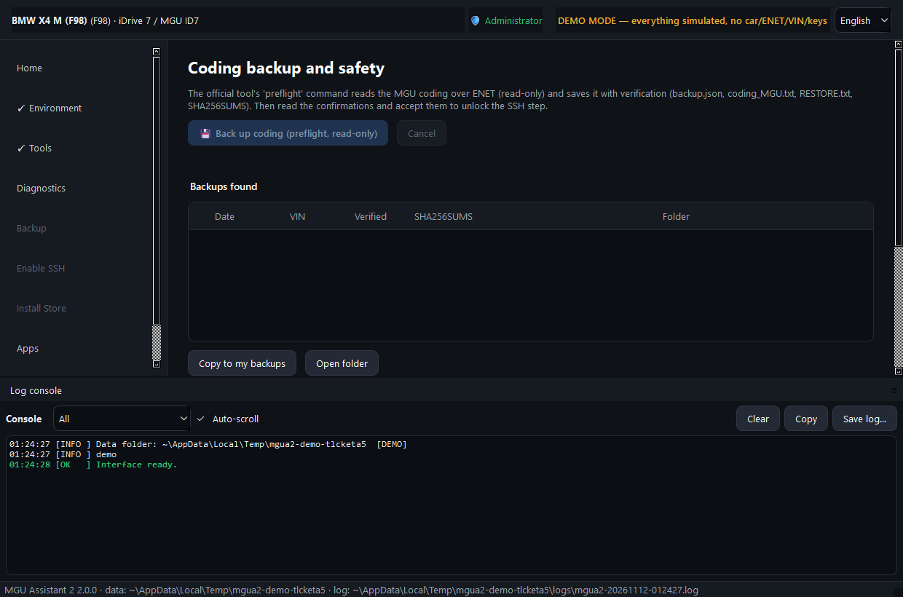
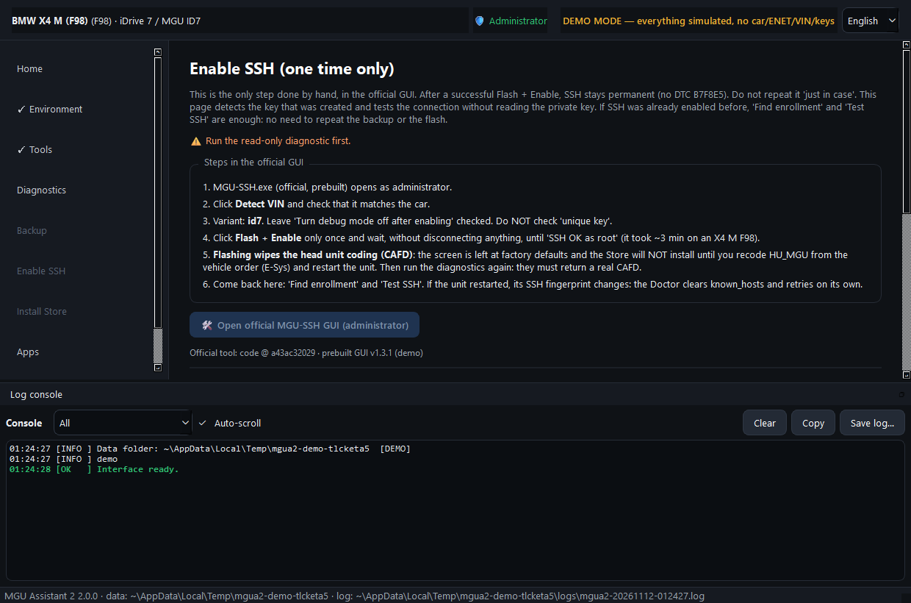
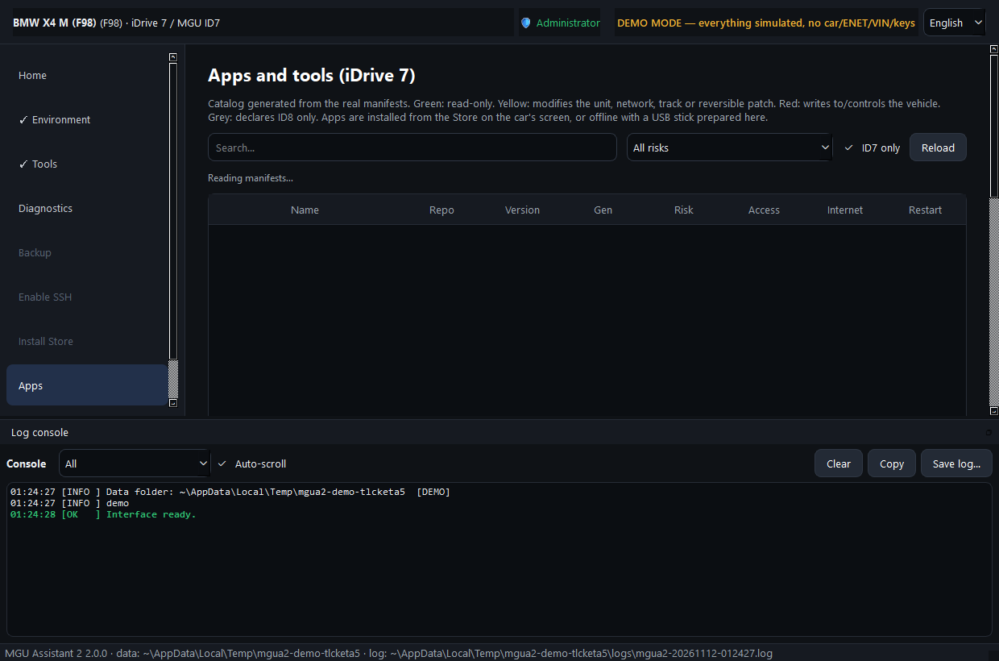
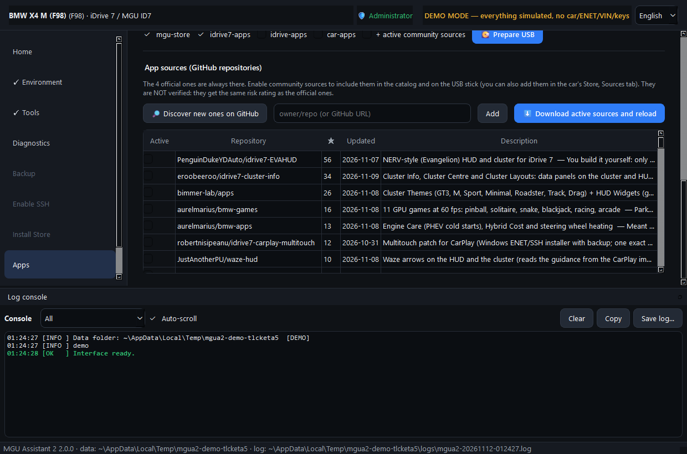

# MGU Assistant 2

**English** | [Español](README.es.md)

An automated Windows installer and assistant for BMW cars with **iDrive 7 (MGU ID7)**. It drives
the community tools that unlock root SSH on the head unit and install the
[MGU Store](https://github.com/robertnisipeanu/mgu-store), in one guided window with a live
console and a **Doctor** that recognises common failures and fixes the ones it safely can.

The interface is in **English and Spanish** (selector at the top right, or `--lang en|es`). Tested on a 2021 BMW X4 M (F98), but nothing in it is specific to that
model: what is allowed depends on what the car's own diagnostics report (SVK / BTLD), never on the
model you pick.

> **Disclaimer.** Unofficial hobby project, not affiliated with BMW AG. Enabling SSH **reprograms
> part of the head unit's software and erases its coding (CAFD)**. It also deletes the BMW Digital
> Key pairings and resets driver profiles. You need a way to recode `HU_MGU` afterwards
> (E-Sys, BimmerCode or a workshop). It may affect your warranty. Work on a parked car with a
> regulated power supply. Read [SECURITY.md](SECURITY.md) and the section
> [After the flash](#after-the-flash-the-coding-is-erased) first.

**Status: 2.0.0-beta.** Used on a real car (X4 M F98, iDrive 7 016.012): read-only diagnostics,
coding backup, the one-time flash in the official GUI (about 3 minutes), `enable`/`persist`, root
SSH with debug mode off and no DTC. The MGU Store and apps were then installed after recoding
`HU_MGU`. iDrive 8 / 8.5 are out of scope by design.

**Download:** the portable Windows build is on the
[Releases page](https://github.com/ALMSTRA/mgu-assistant-2/releases). Unzip it anywhere (a USB
stick works) and keep the folder together. It isn't signed, so SmartScreen warns the first time:
choose _More info_ and _Run anyway_.

## Screenshots

| Home | Read-only diagnostics |
| --- | --- |
|  |  |

| Coding backup | Enable SSH |
| --- | --- |
|  |  |

| App catalog | Community sources |
| --- | --- |
|  |  |

## What it does

| Step | Automated | How |
| --- | --- | --- |
| Tools | ✅ | Downloads the SSH tool's source (GitHub zip, no git needed), the prebuilt `MGU-SSH.exe`, the standalone `mgu-install` (SHA-256 verified) and the app repositories. Keeps your enrollments and backups when updating. |
| Environment | ✅ | Doctor: administrator rights (relaunch with UAC), OpenSSH client (installs it), internet, ENET adapter with a `169.254.x.x` address. |
| Diagnostics | ✅ | Runs the official read-only `status` with **its own bundled interpreter** (no Python needed on the laptop). Rejects NBT/EVO units and gates on BTLD `00003F36`. Shows whether the coding (CAFD) is present. If discovery fails it retries with the last gateway seen on that car, then reports the ENET link: adapter, ARP neighbours and a port-22 probe. |
| Backup | ✅ | Official `preflight`: reads the MGU coding over ENET, verified, with `SHA256SUMS`. One "I accept" button for the safety checklist. |
| Enable SSH | 👤 once | Opens the official GUI as administrator for the single flash. Afterwards it finds the enrollment, locates the unit even if its IP changed, and tests SSH without reading the private key. |
| Store | ✅ | `mgu-install first-install` over the car's Wi-Fi hotspot or ENET. Blocked, with an explanation, while the coding is erased. |
| Apps | ✅ catalog / 💽 USB | Catalog read from the real manifests, colour-coded by risk, and an offline **USB stick** (`usb-repo`). |
| Sources | 🔎 | The 4 sources the Store seeds plus **78 verified community repositories** (cluster themes, HUD widgets, games, video, utilities), live GitHub search and your own `owner/repo`. All opt-in and unverified. Repositories known to overwrite official tools or the Store itself are blocked. |

Flashing is never automated: the app opens the official `MGU-SSH.exe` and you press the button.
It never passes `--force` or `--yes`, and it never writes coding to the car.

## Run

```
MGU-Assistant-2.exe              # normal mode (press "Prepare everything")
MGU-Assistant-2.exe --demo       # everything simulated, no car needed
MGU-Assistant-2.exe --lang es    # Spanish interface
```

The folder must stay together: `MGU-Assistant-2.exe` (GUI) and `mgua2-cli.exe` (console; it acts
as the Python interpreter for the official tool). Demo mode always works in a fresh temporary
folder and never touches your real data.

User data lives in `%LOCALAPPDATA%\MGU Assistant 2\` (`tools/`, `repos/`, `logs/`, `backups/`,
`state/`, `usb/`). The console redacts VINs, keys, tokens and your Windows user name.

**Resuming with SSH already enabled:** on start the app detects the enrollment (key and unit IP)
and unlocks "Habilitar SSH" directly: Diagnostics (optional), then Test SSH, then Install Store. No
backup or flash again. If port 22 is closed, "Enable" re-enrolls without flashing.

## After the flash: the coding is erased

What happened on the test car, and what the research found (about 30 public reports, none kept
its coding):

- The flash replaces **one software element**, `SWFL 000056EA` (to `030.016.002`), with **no coding
  step**. In BMW's own tools programming is always followed by coding, so the CAFD slot is left
  empty: the SVK shows `CAFD FFFFFFFF_255.255.255` and the unit runs on defaults. The screen resets
  to factory settings.
- `mgu-install` refuses with exit code 2 ("coding is missing: it holds default values"), because
  without valid coding the app manager never starts.
- It happens on **every** flash or `fix-key`, whatever the previous version. Activating debug mode
  (the flash, and every `enable`) also resets the driver profile, seat memory and BMW ID login. The
  app warns about this and won't run `enable` when port 22 is already open.
- Fix: recode `HU_MGU` by vehicle order (E-Sys, or a workshop with E-Sys/ISTA); BimmerCode worked
  for some users, including the test car. Then restart the unit, run the diagnostics again (a real
  CAFD must come back) and install the Store. Never re-flash to fix coding.

The app detects the erased CAFD, blocks the Store step with these instructions and links the
backup's `RESTORE.txt` and the upstream issue.

## Development

```
python -m venv .venv
.venv\Scripts\python -m pip install -r requirements-dev.txt
.venv\Scripts\python -m mgua2 --demo
set QT_QPA_PLATFORM=offscreen && .venv\Scripts\python -m pytest -m "not net"
powershell -File packaging\windows\build.ps1
```

`packaging/mgua2.spec` builds two executables in one PyInstaller folder. Never build while the app
is running from `dist/`: the Qt DLLs are locked and the build ends half-updated (the build script
refuses). Tests marked `net` call the GitHub API, whose anonymous quota is 60 requests per hour.
Interface texts are written in both languages where they are used: `tr("Probar SSH", "Test SSH")`
(see `mgua2/i18n.py`).

Layout: `mgua2/core` (paths, redacted log bus, state machine, demo), `mgua2/services` (tools,
runner, SSH tool wrapper, Store installer, Doctor, network, sources), `mgua2/catalog` (manifest
scanner and risk classifier), `mgua2/ui` (PySide6 pages), `tests/`.

## Limitations

- Windows only for flashing: the prebuilt `MGU-SSH.exe` exists only for Windows. macOS scripts
  are included but untested.
- Community sources are unverified: read each repository before enabling it.
- Built against the upstream tools as of November 2026; their output format may change.

## Credits and licences

Own code: MIT ([LICENSE](LICENSE)). It orchestrates, and downloads at run time, the work of others:
[idrive7-8-ssh-root](https://github.com/cauliflowermossgrape/idrive7-8-ssh-root) (Unlicense),
[mgu-store](https://github.com/robertnisipeanu/mgu-store) (GPL-3.0),
[idrive7-apps](https://github.com/cauliflowermossgrape/idrive7-apps) (MIT),
[idrive-apps](https://github.com/robertnisipeanu/idrive-apps) (GPL-3.0) and
[car-apps](https://github.com/IterioDev/car-apps). See [THIRD_PARTY_NOTICES.md](THIRD_PARTY_NOTICES.md).
